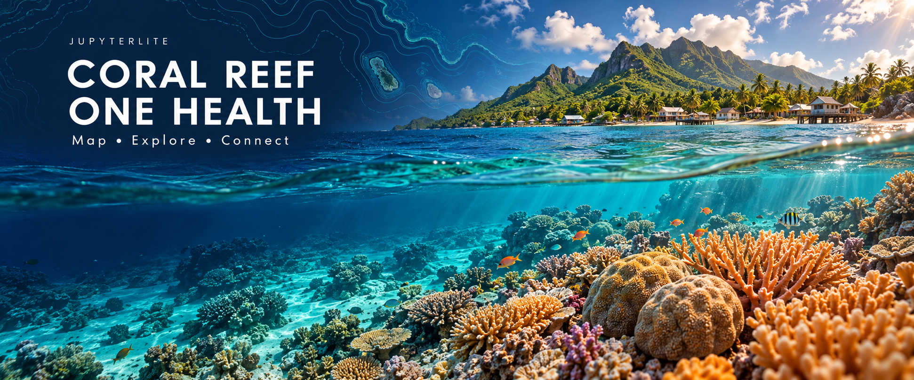

<!-- Generated by scripts/render_readme.py from templates/README.md and site.json. -->
# JupyterLite-Coral-Reef-One-Health



**Explore coral reef mapping and the connections between ecosystems, animals, and people.**

[**Read the Jupyter Book →**](https://jltobias.github.io/JupyterLite-Coral-Reef-One-Health/book/) · [**Launch JupyterLite Lab →**](https://jltobias.github.io/JupyterLite-Coral-Reef-One-Health/lite/lab/index.html) · [**Open the first notebook →**](https://jltobias.github.io/JupyterLite-Coral-Reef-One-Health/lite/lab/index.html?path=01-reef-mapping.ipynb)

The Book introduces the science and sources. Lab lets you run and change Python notebooks entirely in your browser, without an account or a local Python installation.

> These are the publication URLs for this repository. They become available after the first successful GitHub Pages deployment. This initial scaffold does not publish itself until it is pushed and Pages is enabled.

## Explore the resources

| Initiative | Explore |
| --- | --- |
| **Allen Coral Atlas** | [Global shallow reef habitat maps and monitoring tools](https://allencoralatlas.org/), with [methods and product limitations](https://allencoralatlas.org/methods/) |
| **Khaled bin Sultan Living Oceans Foundation** | [Global Reef Expedition mapping and NASA collaboration](https://www.livingoceansfoundation.org/mapping-the-worlds-coral-reefs/) and the [World Reef Map](https://maps.lof.org/) |
| **Millennium Coral Reef Mapping Project** | [IMaRS project](https://imars.usf.edu/millennium-corals/), [NASA historical summary](https://landsat.gsfc.nasa.gov/wp-content/uploads/2012/07/coral-l7.pdf), and [UNEP-WCMC global reef dataset](https://data-gis.unep-wcmc.org/portal/home/item.html?id=0613604367334836863f5c0c10e452bf) |

The Book compares these initiatives and connects them to the [One Health approach](https://www.who.int/health-topics/one-health), drawing on [Sweet, Burian, and Bulling's review](https://pubmed.ncbi.nlm.nih.gov/33545133/). The [Coral Reef Alliance article on reefs and human health](https://coral.org/blog/the-surprising-connections-between-coral-reefs-and-human-health/) provides a discussion reading. The lessons distinguish historical launch claims from current products and connect maps to questions that need field and community evidence.

## Continue exploring

[Awesome coral research](https://github.com/luismmontilla/awesome-coral-research), maintained by **luismmontilla and contributors**, is a useful discovery directory. Our [research-tools guide](book/research-resources.md) connects selected resources to learning activities involving NOAA Coral Reef Watch, MERMAID, CoralNet, and OBIS. These external services are not installed in the starter Lab. The directory and all selected providers are credited below.

## Run the notebooks

1. Launch [JupyterLite Lab](https://jltobias.github.io/JupyterLite-Coral-Reef-One-Health/lite/lab/index.html) and allow the Python kernel to finish loading.
2. Open `01-reef-mapping.ipynb` or `02-one-health.ipynb`.
3. Select **Run → Run All Cells**, then change a question or indicator weight and rerun.
4. Download notebooks you want to keep using **File → Save and Export Notebook As → Notebook**.

The notebooks use bundled data and Python's standard library. The first explores a cited resource catalogue; the second compares **fictional sites and synthetic indicators**. No provider habitat data are redistributed. The teaching score is not a validated health or conservation index.

An internet connection is needed for the first Python runtime download. Work is stored in this browser; clearing site data or switching browsers can remove access to unsaved work. Download copies before leaving. If data files are unavailable in Python, refresh Lab after its service worker activates and allow site storage, or download the notebook and data to run locally.

## Build and preview locally

Use **Python 3.12 or newer** and [uv](https://docs.astral.sh/uv/getting-started/installation/). A Node.js runtime is included in the pinned build environment for Jupyter Book 2.

```shell
uv venv --python 3.12
uv pip sync requirements.txt
uv run python scripts/render_readme.py --check
uv run python scripts/check_notebooks.py
uv run python scripts/build.py --local
uv run python -m http.server 8000 --directory _site
```

Open [the local portal](http://localhost:8000/), [the local Book](http://localhost:8000/book/), or [the local Lab](http://localhost:8000/lite/lab/index.html). The Book's published Lab action points to the public site; the local portal opens the local Lab. For a production build with the repository URL prefix, omit `--local`.

## Publish on GitHub Pages

1. Push this repository to [GitHub](https://github.com/jltobias/JupyterLite-Coral-Reef-One-Health) on `main`.
2. In **Settings → Pages → Build and deployment**, choose **GitHub Actions** as the source.
3. Open **Actions → Build and publish → Run workflow**, or push another change to `main`.
4. After deployment succeeds, visit [the project portal](https://jltobias.github.io/JupyterLite-Coral-Reef-One-Health/). Book and Lab are published together under `/book/` and `/lite/`.

Pull requests build and validate the complete site without deploying it. The workflow runs notebook execution checks, detects stale generated README content, and uploads one Pages artifact. The `github-pages` environment may require approval if you configure protection rules.

## Repository guide

| Path | Purpose |
| --- | --- |
| `book/`, `myst.yml`, `references.bib` | Jupyter Book 2 lessons, navigation, and bibliographic records |
| `content/` | The same notebooks used by the Book and Lab, plus local data |
| `assets/` | Original splash illustration and generation provenance |
| `site.json`, `templates/README.md` | Publication settings and editable README source |
| `scripts/` | README generation, notebook verification, and combined build |
| `.github/workflows/deploy.yml` | Build checks and GitHub Pages publication |

To change this README, edit `templates/README.md` or `site.json`, then run `uv run python scripts/render_readme.py`. When forking, update `site.json` and the published URLs in `myst.yml` and `book/index.md`; the deployment workflow derives its base path from the GitHub repository. For a custom domain, set `pages_url` in `site.json` and adapt the build's base path.

To update dependencies deliberately, edit `requirements.in`, run `uv pip compile requirements.in --universal --output-file requirements.txt`, sync, and rebuild. External resources retain their own licenses and access terms. See [references and data use](book/references.md); a repository-wide license has not yet been selected.

## Citations and attributions

The sources below support the README, Book, and notebook context. Sources were checked on **2 November 2026**. Descriptions are paraphrased; no external reef datasets, photographs, article text, or organization logos are bundled. Source organizations are credited for their own work and do not endorse this project.

### Reef mapping

1. **Allen Coral Atlas / Arizona State University and partners.** [Allen Coral Atlas](https://allencoralatlas.org/) and [Science & Methods](https://allencoralatlas.org/methods/). Sources for current habitat mapping, monitoring tools, methods, and product limits.
2. **Coral Reef Alliance.** [The Allen Coral Atlas Introduces the First Comprehensive Map of Shallow Water Coral Reefs](https://coral.org/blog/the-allen-coral-atlas-introduces-the-first-comprehensive-map-of-shallow-water-coral-reefs/). Historical account of the 2021 launch.
3. **Khaled bin Sultan Living Oceans Foundation (KSLOF).** [Mapping the World's Coral Reefs](https://www.livingoceansfoundation.org/mapping-the-worlds-coral-reefs/) and [World Reef Map](https://maps.lof.org/). Sources for Global Reef Expedition mapping, field validation, NASA collaboration, and data-access information.
4. **NASA Landsat / University of South Florida IMaRS.** [Landsat 7 Worldwide Inventory of Coral Reefs Completed](https://landsat.gsfc.nasa.gov/wp-content/uploads/2012/07/coral-l7.pdf). Historical source for Millennium mapping and its 1999–2002 imagery.
5. **University of South Florida, Institute for Marine Remote Sensing (IMaRS).** [Millennium Corals](https://imars.usf.edu/millennium-corals/). Original project resource; the supplied page timed out during review. [IMaRS homepage](https://imars.usf.edu/) provides supporting project context.
6. **UNEP World Conservation Monitoring Centre (UNEP-WCMC).** [Global Distribution of Coral Reefs dataset record](https://data-gis.unep-wcmc.org/portal/home/item.html?id=0613604367334836863f5c0c10e452bf) and [Ocean+ Habitats access guidance](https://habitats.oceanplus.org/). Inspect provider metadata and requested dataset citations before use; the interactive dataset record did not expose readable metadata to the review tool.

### One Health and human wellbeing

7. **World Health Organization.** [One Health overview](https://www.who.int/health-topics/one-health). Source for the cross-sector framework.
8. **Sweet, M., Burian, A., and Bulling, M. (2021).** Corals as canaries in the coalmine: Towards the incorporation of marine ecosystems into the 'One Health' concept. *Journal of Invertebrate Pathology*, **186**, 107538. [DOI: 10.1016/j.jip.2021.107538](https://doi.org/10.1016/j.jip.2021.107538) · [PubMed: 33545133](https://pubmed.ncbi.nlm.nih.gov/33545133/). The indexed abstract was reviewed; full text was not reviewed.
9. **Coral Reef Alliance (13 January 2025).** [The Surprising Connections Between Coral Reefs and Human Health](https://coral.org/blog/the-surprising-connections-between-coral-reefs-and-human-health/). Introductory reading used for discussion and examination of evidence.
10. **National Oceanic and Atmospheric Administration (NOAA).** [Coral reef ecosystems](https://www.noaa.gov/education/resource-collections/marine-life/coral-reef-ecosystems). Source for ecosystem services and cultural context.
11. **McGowan, H. A., MacKellar, M. C., and Gray, M. A. (2016).** Direct measurements of air-sea CO₂ exchange over a coral reef. *Geophysical Research Letters*, **43**, 4602–4608. [DOI: 10.1002/2016GL068772](https://agupubs.onlinelibrary.wiley.com/doi/10.1002/2016GL068772). The Book uses this field study to qualify broad carbon-sink claims.

### Additional supplied resources

These were retained as further reading. Full content was unavailable to the review tool, and detailed claims do not rely on them.

12. [Allen Coral Atlas video supplied with the project](https://www.youtube.com/watch?v=Dc-i9_2cbSk). Creator and rights belong to the uploader identified on YouTube; metadata could not be verified.
13. [KSLOF mapping video supplied with the project, at 95 seconds](https://www.youtube.com/watch?v=tWbnWMxZCcY&t=95). Creator and rights belong to the uploader identified on YouTube; metadata could not be verified.
14. [ScienceDirect article, PII S2949790624000016](https://www.sciencedirect.com/science/article/pii/S2949790624000016). Author, title, and license metadata could not be verified because access was blocked; consult the publisher record for attribution before reuse.
15. **Mongabay (September 2021).** [The first complete map of the world's shallow tropical coral reefs is here](https://news.mongabay.com/2021/09/the-first-complete-map-of-the-worlds-shallow-tropical-coral-reefs-is-here/). Supplied historical coverage; full text and byline were unavailable during review.

### Software, bundled data, and illustration

16. **Project Jupyter and JupyterLite contributors.** [JupyterLite documentation](https://jupyterlite.readthedocs.io/en/stable/), [GitHub Pages deployment](https://jupyterlite.readthedocs.io/en/stable/quickstart/deploy.html), and [kernel filesystem access](https://jupyterlite.readthedocs.io/en/stable/howto/content/python.html). Sources for the browser environment and deployment behavior. [JupyterLite source and license](https://github.com/jupyterlite/jupyterlite).
17. **Jupyter Book / MyST contributors.** [Jupyter Book 2 documentation](https://jupyterbook.org/stable/), [static website builds](https://jupyterbook.org/stable/build-and-publish/website/), and [MyST hosting and base URLs](https://mystmd.org/guide/deployment). Sources for Book configuration and publishing. [Jupyter Book source and license](https://github.com/jupyter-book/jupyter-book).
18. **Astral and uv contributors.** [uv installation and documentation](https://docs.astral.sh/uv/getting-started/installation/). Build-environment tooling; [source and licenses](https://github.com/astral-sh/uv).
19. **OpenAI image generation tool.** The original AI-generated [splash illustration](assets/reef-splash.png) was created for this project on 2 November 2026. It is an illustration of a fictional reef setting, not a scientific observation or photograph. [Full generation prompt and provenance](assets/README.md).
20. **This repository.** The short mapping catalogue, lesson prose, notebooks, and synthetic reef-site CSV were authored for this project. The CSV represents fictional sites; none of its values are provider observations. All third-party datasets and software retain their own terms and required attributions.

### Research tools and discovery

21. **luismmontilla and contributors.** [Awesome coral research](https://github.com/luismmontilla/awesome-coral-research). Discovery source for our selected tool links, checked on 2 November 2026. The collection declares [Creative Commons Attribution 4.0 International](https://creativecommons.org/licenses/by/4.0/) in its [license file](https://github.com/luismmontilla/awesome-coral-research/blob/master/LICENCE.md). Our guide selects four links, paraphrases descriptions using provider sources, and adds learning activities; it does not copy the full directory or its header image. Provider-specific terms still apply.
22. **NOAA Coral Reef Watch.** [Satellite monitoring and products portal](https://coralreefwatch.noaa.gov/satellite/index.php). Source for the guide's satellite temperature, heat-stress, and bleaching-alert descriptions.
23. **MERMAID team / Wildlife Conservation Society.** [MERMAID](https://datamermaid.org/). Source for survey collection, exploration, and data-management capabilities.
24. **CoralNet team.** [CoralNet](https://coralnet.ucsd.edu/). Source for image organization, annotation, and annotation-statistics capabilities.
25. **OBIS contributors.** [Ocean Biodiversity Information System](https://obis.org/). Source for marine biodiversity data discovery. The guide links to the service and does not redistribute occurrence data.
